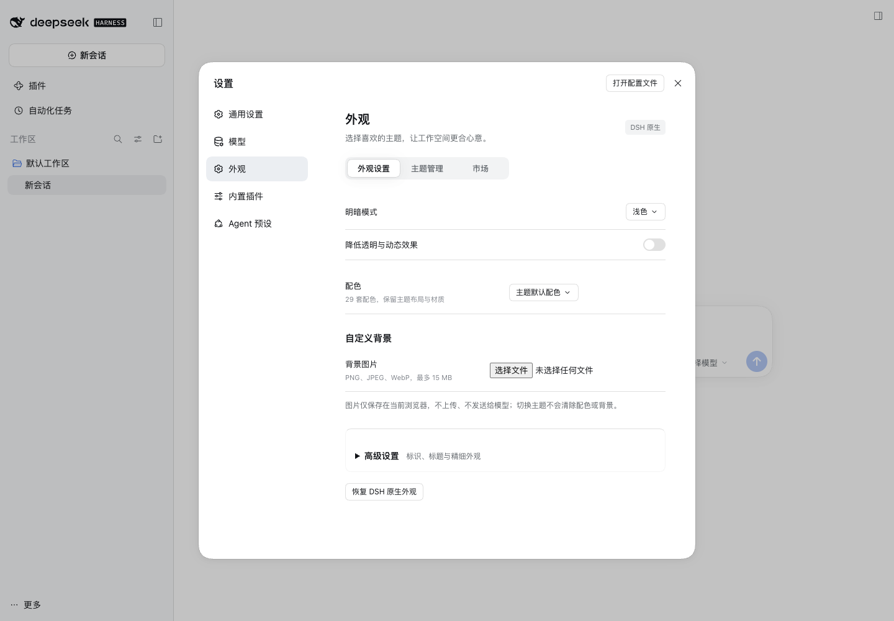

# dsh-theme-plugin

在 DeepSeek Harness 中管理外观、浏览带图片的社区主题市场，并一键下载、检查和应用主题。

[English](README_EN.md) · [实际兼容范围](docs/compatibility.md) · [开发与适配](docs/development.md) · [AI 修复指南](docs/ai-repair.md)

设置 → **外观**包含三个页面：

- **外观设置**：明暗模式、配色、背景、字体、尺寸、圆角、透明度、动态效果、标识与标题，以及受支持主题的专属设置。
- **主题管理**：内置主题、已有主题、文件导入、启用、导出、移除和问题处理。
- **市场**：图片、说明、作者、来源、搜索与风格筛选；安装前检查，成功后应用。

内置 DSH 原生、Glyph 动态字符、Codex Desktop、iOS Liquid Glass、Claude CLI 和 Google Material 外观，提供 29 套配色。默认名称与浏览器标题使用 DeepSeek Harness，主题继续保留自己的字体和视觉效果。

## 安装

仅适用于 **DSH 0.2.1-rc.2**、**Node.js 22.19+**。打开 **插件 → ＋ 添加插件**，粘贴固定安装包地址：

```text
https://github.com/gulagala001/dsh-theme-plugin/releases/download/v0.1.0-dsh.0.2.1-rc.2/gulagala001-dsh-theme-plugin-0.1.0-dsh.0.2.1-rc.2.tgz
```

按宿主提示启用；如需重启，请先结束当前任务。随后打开设置 → 外观。首次使用会识别 profile 中已安装的主题，原生插件继续由 DSH 管理。

安装标识为 `@gulagala001/dsh-theme-plugin`，本版通过 GitHub Release 分发。请使用上面的固定地址，无作用域的 npm 同名包属于其他作者。

[完整安装指南与复制给 AI 的指令](docs/install.md) · [版本说明](https://github.com/gulagala001/dsh-theme-plugin/releases/tag/v0.1.0-dsh.0.2.1-rc.2) · [SHA256SUMS](https://github.com/gulagala001/dsh-theme-plugin/releases/download/v0.1.0-dsh.0.2.1-rc.2/SHA256SUMS)

CLI 示例（`web` 换成实际使用的 profile）：

```sh
dsh plugin --profile web add https://github.com/gulagala001/dsh-theme-plugin/releases/download/v0.1.0-dsh.0.2.1-rc.2/gulagala001-dsh-theme-plugin-0.1.0-dsh.0.2.1-rc.2.tgz
```

## 界面预览




截图来自独立 DSH profile 的演示界面；市场预览及作品名称归原作者所有。目录数量会随上游变化，不代表全部兼容。

## 使用

打开设置 → 外观 → 市场，选择主题，点击**安装并应用**。主题先下载到暂存区，检查文件、样式和资源；包含样式、背景或客户端脚本的主题还会在独立 DSH 与浏览器中验证，包括界面可见性。通过后进入主题库。

已有主题可从“主题管理”查看，也可导入 `.json`、`.zip` 或 `.tgz`。安装失败会保留当前外观，并提供**复制给 AI 修复**。将 AI 返回的修复包重新导入即可再次检查。

动态预检使用匹配的 DSH CLI 和独立浏览器。优先复用可用的 Chromium、Chrome 或 Edge；没有时自动准备固定版本的 Chromium，首次使用需要下载时间。检查环境无法准备时，主题保持未安装状态，界面会给出原因。现有主题插件若只能重启切换，界面会明确说明，不会将它与新主题叠加。

市场条目来自社区目录，不代表每个主题都已兼容。预览与说明归原作者所有；具体支持格式、样本和限制见[兼容说明](docs/compatibility.md)。

## 数据与恢复

主题库及资源位于 DSH 数据目录的 `dsh-theme-plugin/` 下，按 profile 区分。外观偏好保存在当前浏览器，已有自定义背景仍使用本地浏览器存储。下载与适配不会改写上游原包。

插件读取当前 profile 的主题清单，通过原生插件管理器协调启停，并写入自己的主题库。市场浏览和安装会请求社区目录、GitHub、npm 或作品声明的公开资源地址；隔离预检启动匹配的 DSH CLI 与浏览器，必要时下载 Chromium。插件不需要模型 API Key，也不向市场上传会话内容。

启用采用可恢复事务；未完成的启用会在下次启动时恢复之前的选择。宿主或适配器版本变化后，受影响的动态主题需要重新检查。运行检查覆盖常见加载故障，无法证明所有设备、插件组合或延迟触发行为都不会出错。

代码采用 MIT 许可；第三方来源及字体许可见 [THIRD_PARTY_NOTICES.md](THIRD_PARTY_NOTICES.md)。
