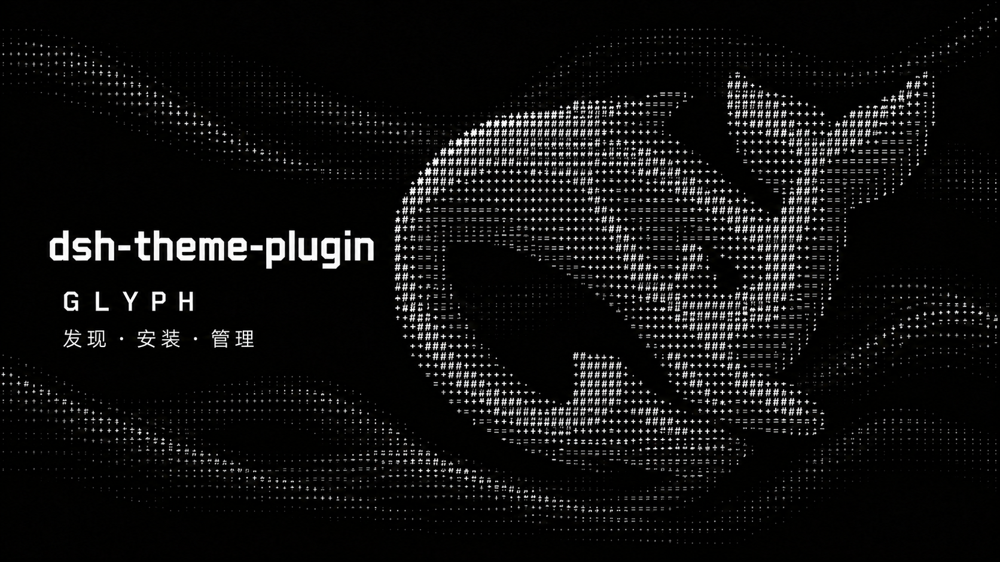
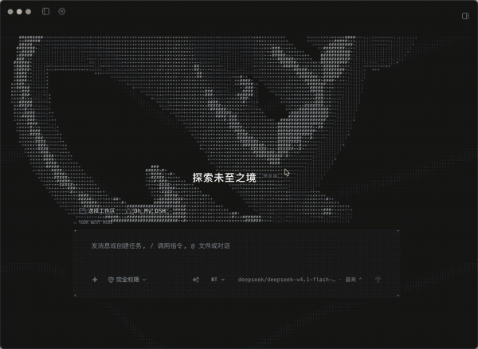
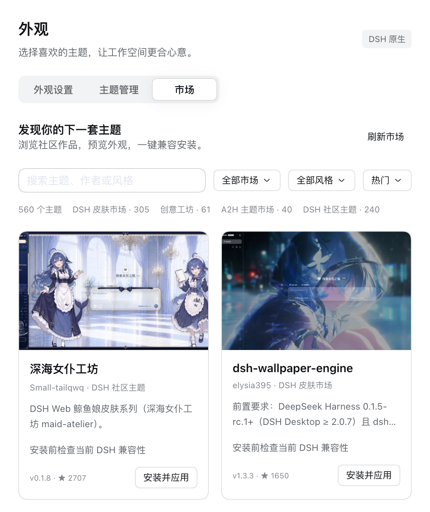
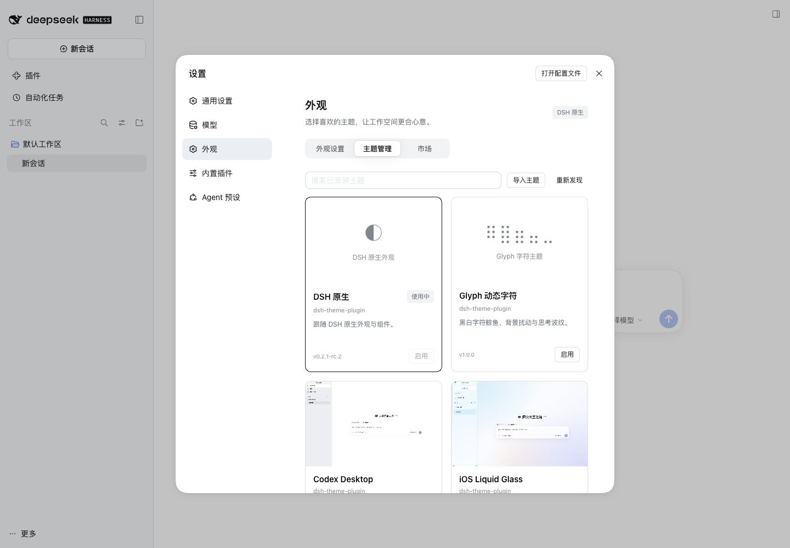

<a id="readme-top"></a>

<h1 align="center">DSH Theme</h1>

<p align="center"><strong>在 DSH 里逛社区主题市场，一键安装，装之前先替你试跑一遍。</strong><br>DeepSeek Harness 插件</p>

<p align="center"><strong>简体中文</strong> · <a href="README_EN.md">English</a></p>

<p align="center">
  <a href="https://github.com/gulagala001/dsh-theme-plugin/releases/tag/v0.3.4-dsh.0.2.2-rc.2"></a>
  <a href="https://github.com/gulagala001/dsh-theme-plugin/releases"></a>
  <a href="#readme-install"></a>
  <a href="https://github.com/gulagala001/dsh-theme-plugin/stargazers"></a>
</p>

<p align="center"><a href="#readme-install"><strong>开始使用</strong></a> · <a href="docs/compatibility.md">支持哪些主题</a> · <a href="https://github.com/gulagala001/dsh-theme-plugin/issues">反馈</a></p>

<p align="center"><a href="docs/images/theme-hero-zh.png"></a></p>

<p align="center"><a href="docs/images/glyph-animation.gif"></a></p>

<a id="readme-install"></a>

## 快速开始

**需要：** DSH **0.2.2-rc.2**，Node.js **24.9.0+**。

### 1. 安装

在 DSH 里打开 **插件 → ＋ 添加插件**，粘贴：

```text
https://github.com/gulagala001/dsh-theme-plugin/releases/download/v0.3.4-dsh.0.2.2-rc.2/gulagala001-dsh-theme-plugin-0.3.4-dsh.0.2.2-rc.2.tgz
```

等手头的任务跑完，按提示启用或重启 DSH，原来的设置和会话都还在。命令行安装、升级和卸载见[安装指南](docs/install.md)，校验文件：[SHA256SUMS](https://github.com/gulagala001/dsh-theme-plugin/releases/download/v0.3.4-dsh.0.2.2-rc.2/SHA256SUMS)。

### 2. 先试一件事

打开 **设置 → 外观 → 市场**，挑一套主题，点 **安装并应用**。

检查通过后外观会直接切换，主题出现在 **主题管理** 里。检查没通过时外观不变，并告诉你原因。

## 三个页面

| 页面 | 能做什么 |
| --- | --- |
| **外观设置** | 明暗、配色、背景、字体、尺寸、圆角、透明度、动效、Logo 和标题，以及主题自带的设置 |
| **主题管理** | 查看内置、已装、导入和市场来的主题；启用、导出、移除、更新 |
| **市场** | 汇总多个主题市场，带预览图、说明和作者，可以搜索、按风格筛选、按热门或最新排序 |

内置 DSH 原生、Glyph 动态字符、Codex Desktop、iOS Liquid Glass、Claude Desktop、Claude CLI 和 Google Material 几套外观，外加 30 套配色。刚装好时保持 DSH 原来的样子；如果你之前装过别的主题，会接着用你当时的选择。



### 已经装过的主题也能管

之前用 DSH 装好的主题插件会自动出现在主题管理里，由这里统一开关，不会同时跑两份。也可以导入 `.json`、`.zip`、`.tgz` 格式的主题文件。



### 装之前先试跑

动态主题（带脚本或后台的）在装进你的 DSH 之前，会先在一个单独的 DSH 和浏览器里跑一遍：加载页面、输入文字、打开设置、切换明暗、卸载再装回。有问题就不装，你当前的外观保持不变。市场里的旧版本会先找同一作者的新版。

这一步能发现常见的启动和显示问题，但它不是安全沙箱：主题本质上是插件，能执行代码。只装你信得过的作者的主题。详细说明见[支持哪些主题](docs/compatibility.md)。

## 常见问题

<details>
<summary>安装为什么要等一会儿？</summary>

动态主题要先在单独的 DSH 和浏览器里试跑。电脑上没有 Chrome、Edge 或 Chromium 时，第一次会下载一个浏览器，所以会慢一些。

</details>

<details>
<summary>主题装不上怎么办？</summary>

先看提示里的原因。点 **复制给 AI 修复**，把内容发给 AI，它会帮你改出一个能用的主题包，再从 **主题管理 → 导入主题** 导入即可，你不用自己写代码。见 [AI 修复指南](docs/ai-repair.md)。

</details>

<details>
<summary>升级 DSH 之后主题还能用吗？</summary>

插件只标明已经适配过的 DSH 版本。DSH 升级后，受影响的主题会重新检查一遍；主题文件和设置都会保留，没通过之前先用能正常显示的外观。

</details>

## 数据、开发和许可

主题库在 `DSH_HOME/dsh-theme-plugin/`，每个 profile 一份；外观偏好和自定义背景还会存一份在浏览器本地。浏览市场只读取公开目录，安装时从 GitHub、npm 或主题自己的地址下载。管理主题不需要模型 Key，也不会上传你的会话。

[开发与构建](docs/development.md)。代码用 [MIT](LICENSE) 许可；字体、组件等来源见 [THIRD_PARTY_NOTICES.md](THIRD_PARTY_NOTICES.md)，第三方主题素材沿用各自的许可。

反馈问题请写明 DSH 和插件版本、主题名称、操作步骤、期望和实际结果，日志和截图先去掉个人信息：[Issues](https://github.com/gulagala001/dsh-theme-plugin/issues)。
