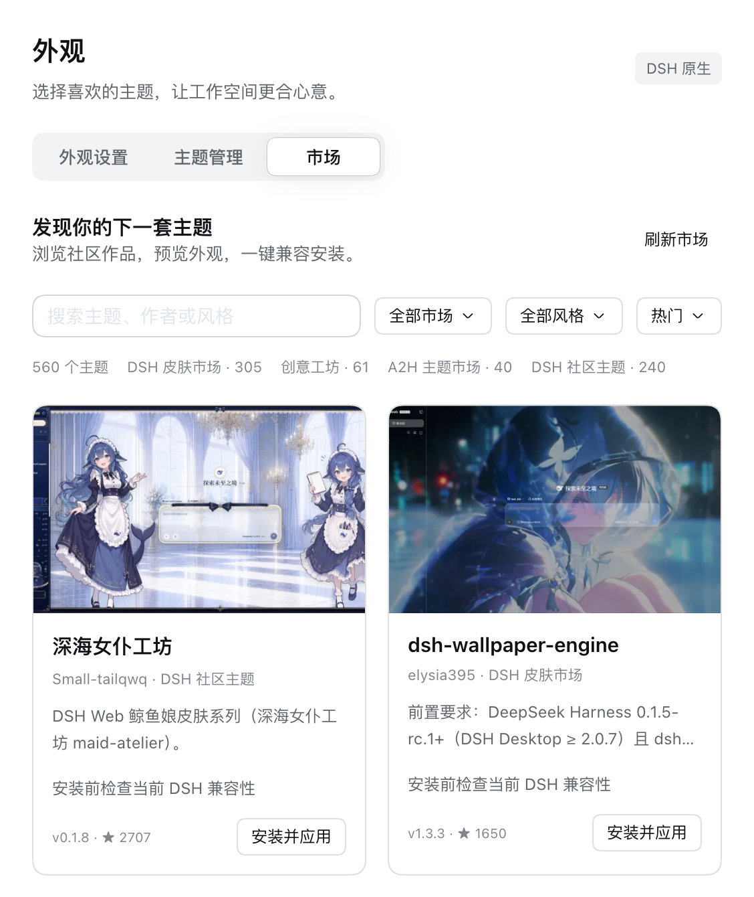
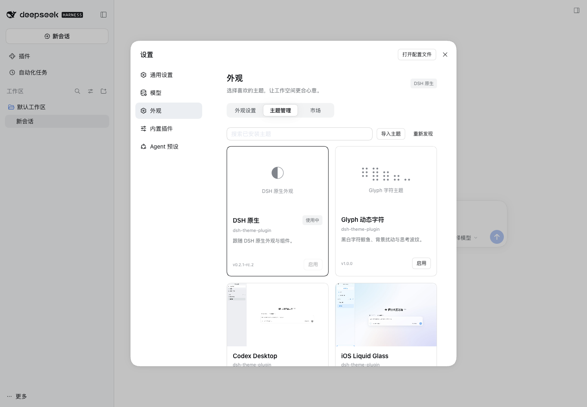

<a name="readme-top"></a>

<h1 align="center">dsh-theme-plugin</h1>

<p align="center"><strong>Discover, check, install and manage community themes.</strong><br>DeepSeek Harness plugin</p>

<p align="center"><a href="README.md">简体中文</a> · <strong>English</strong></p>

<p align="center">
  <a href="https://github.com/gulagala001/dsh-theme-plugin/releases/tag/v0.2.0-dsh.0.2.1-rc.2"></a>
  <a href="https://github.com/gulagala001/dsh-theme-plugin/releases/tag/v0.2.0-dsh.0.2.1-rc.2"></a>
  <a href="#readme-install"></a>
  <a href="https://github.com/gulagala001/dsh-theme-plugin/stargazers"></a>
</p>

<p align="center"><a href="#readme-install"><strong>Get started</strong></a> · <a href="docs/compatibility_EN.md">Docs</a> · <a href="https://github.com/gulagala001/dsh-theme-plugin/issues">Report an issue</a></p>

<p align="center"><a href="docs/images/market.png"></a></p>

*Actual marketplace in an isolated DSH profile. Theme previews belong to their authors; catalog size is not a compatibility count.*

The download badge counts only the linked release’s plugin archive; it is not a count of users or installations.

<a name="readme-install"></a>

## Quick start

**Required environment：** DSH **0.2.1-rc.2**, Node.js **22.19+**.

Compatibility targets the supported DSH version, without restoring obsolete theme APIs. Dynamic themes run in a disposable DSH profile and browser before installation. Themes are third-party plugins whose backends use real host services; preflight is not a security sandbox.

### 1. Install

Open **Plugins → Add plugin** in the DSH instance you use, then paste:

```text
https://github.com/gulagala001/dsh-theme-plugin/releases/download/v0.2.0-dsh.0.2.1-rc.2/gulagala001-dsh-theme-plugin-0.2.0-dsh.0.2.1-rc.2.tgz
```

Wait for active tasks to finish, then follow the host’s activation/restart prompt. Keep your existing profile and data. See the [installation guide](docs/install_EN.md) · [SHA256SUMS](https://github.com/gulagala001/dsh-theme-plugin/releases/download/v0.2.0-dsh.0.2.1-rc.2/SHA256SUMS).

### 2. Try this first

Open **Settings → Appearance → Market**, choose a theme and click **Install and apply**.

**Success looks like：** After pre-install checks pass, the appearance changes and the theme appears in management. A failed check preserves your current appearance and explains the cause.

## Three pages for the whole appearance

| Page | What it manages |
| --- | --- |
| **Appearance settings** | Light/dark, palettes, backgrounds, fonts, sizes, corners, transparency, motion, branding and supported theme-specific settings. |
| **Theme management** | Built-in, existing, imported and market themes; activation, export, removal and updates. |
| **Market** | Multiple sources, image cards, descriptions, authors, search, style filters, popularity/date sorting and one-click installation. |

Includes native DSH, Glyph, Codex Desktop, iOS Liquid Glass, Claude CLI and Google Material appearances, plus 29 palettes. A new installation keeps native appearance; existing themes and migratable preferences retain their selection. The default title is DeepSeek Harness while theme typography, shapes and motion remain intact.

### Bring existing themes into management

Already-installed plugins remain under DSH’s native manager. The theme manager coordinates activation rather than loading a second copy. Import recognized `.json`, `.zip` and `.tgz` formats. Downloads and adaptation preserve upstream originals.



*Actual management UI in an isolated profile. Community artwork belongs to its respective authors.*

### Check the version and runtime before installation

A stale market snapshot is checked for a newer release with matching package and author/repository identity, then pinned to an actual source. Source-only themes can have their clients prepared automatically. Backends use current DSH services with disposable lifecycles. Preflight checks loading, actual input and settings access, light/dark, disposal and remounting. Failure preserves the current usable appearance.

Declared compatibility and runtime results are shown separately. Unchecked catalog entries are not labeled compatible; obsolete host APIs are not forced into the current host. [Supported scope](docs/compatibility_EN.md)

## FAQ

<details>
<summary>Why does installation take a while?</summary>

Dynamic themes are staged and tested in a matching disposable DSH profile and browser. If Chromium/Chrome/Edge is unavailable, fixed browser resources are prepared first. Failed checks are never skipped to complete installation.

</details>

<details>
<summary>What happens with a stale or incompatible theme?</summary>

The manager first checks for an eligible newer version from the same source. If it still fails, the exact version and reason are shown with a copyable AI repair task. Reimported repairs must pass the same checks; users do not need to write adapter code. [AI repair guide](docs/ai-repair.md)

</details>

<details>
<summary>What happens after a DSH upgrade?</summary>

Only adapted host versions are claimed. A host or adapter change triggers rechecking of affected themes; original packages and settings remain available, with a usable appearance restored until checks pass. Future host support is not inferred by widening a version range.

</details>

## Data, development and license

The theme library lives under `DSH_HOME/dsh-theme-plugin/`, separated by profile. Appearance preferences and custom backgrounds also use browser storage. Native theme backends keep their original data locations. Market browsing requests public catalogs; installation uses GitHub/npm/theme resources. The manager itself needs no model key and does not upload conversations to markets.

Preflight detects common startup failures; it does not prove arbitrary third-party code, every device or delayed behavior safe. A theme’s own implementation controls its capabilities and permissions.

[Optional development protocol and build guide](docs/development.md). Code uses [MIT](LICENSE); fonts, components and other sources are listed in [THIRD_PARTY_NOTICES.md](THIRD_PARTY_NOTICES.md). Third-party theme assets retain their original terms.

## Documentation and support

| I want to | Where to go |
| --- | --- |
| Install, update or remove | [Installation guide](docs/install_EN.md) |
| Learn the features and limits | [Documentation](docs/compatibility_EN.md) |
| Read release changes | [Releases](https://github.com/gulagala001/dsh-theme-plugin/releases) |
| Report a problem | [Issues](https://github.com/gulagala001/dsh-theme-plugin/issues) |

For a bug report, include the full DSH and plugin versions, the entry point, minimal reproduction steps, and expected versus actual behavior. Remove private data before sharing logs or screenshots.

<p align="center"><a href="#readme-top">Back to top</a> · <a href="https://github.com/gulagala001/dsh-theme-plugin/releases">Versions and downloads</a> · <a href="https://github.com/gulagala001/dsh-theme-plugin/issues">Feedback</a></p>
