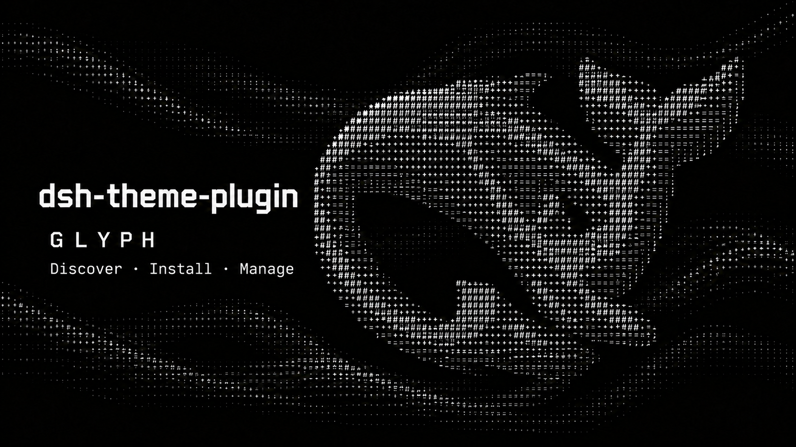
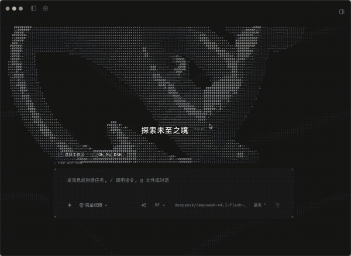
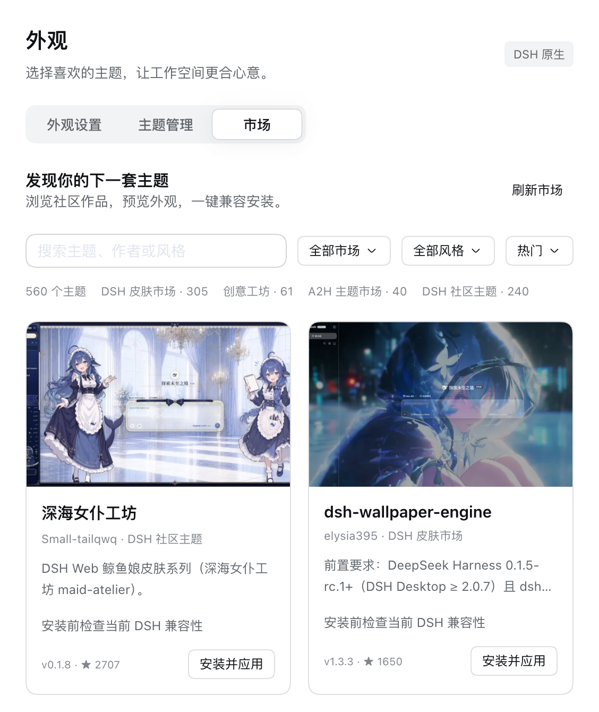
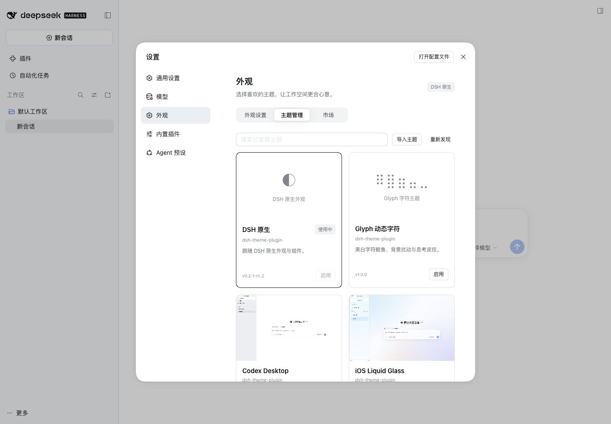

<a id="readme-top"></a>

<h1 align="center">DSH Theme</h1>

<p align="center"><strong>Browse community themes in DSH and install them in one click, after a test run that checks they work.</strong><br>A DeepSeek Harness plugin</p>

<p align="center"><a href="README.md">简体中文</a> · <strong>English</strong></p>

<p align="center">
  <a href="https://github.com/gulagala001/dsh-theme-plugin/releases/tag/v0.3.5-dsh.0.2.2-rc.2"></a>
  <a href="https://github.com/gulagala001/dsh-theme-plugin/releases"></a>
  <a href="#readme-install"></a>
  <a href="https://github.com/gulagala001/dsh-theme-plugin/stargazers"></a>
</p>

<p align="center"><a href="#readme-install"><strong>Get started</strong></a> · <a href="docs/compatibility_EN.md">Supported themes</a> · <a href="https://github.com/gulagala001/dsh-theme-plugin/issues">Feedback</a></p>

<p align="center"><a href="docs/images/theme-hero-en.png"></a></p>

<p align="center"><a href="docs/images/glyph-animation.gif"></a></p>

<a id="readme-install"></a>

## Quick start

**Requires:** DSH **0.2.2-rc.2** and Node.js **24.9.0+**.

### 1. Install

In DSH, open **Plugins → Add plugin** and paste:

```text
https://github.com/gulagala001/dsh-theme-plugin/releases/download/v0.3.5-dsh.0.2.2-rc.2/gulagala001-dsh-theme-plugin-0.3.5-dsh.0.2.2-rc.2.tgz
```

When your current task finishes, enable the plugin or restart DSH when prompted. Your settings and conversations stay as they were. For command-line installs, upgrades and removal, see the [installation guide](docs/install_EN.md). Checksums: [SHA256SUMS](https://github.com/gulagala001/dsh-theme-plugin/releases/download/v0.3.5-dsh.0.2.2-rc.2/SHA256SUMS).

### 2. Try it

Open **Settings → Appearance → Market**, pick a theme and click **Install and apply**.

If the check passes, the appearance switches and the theme shows up in **Theme management**. If it fails, your appearance stays as it was and you see why.

## Three pages

| Page | What you can do |
| --- | --- |
| **Appearance settings** | Light and dark, colors, background, fonts, sizes, corner radius, transparency, motion, logo and title, plus settings a theme brings along |
| **Theme management** | See built-in, installed, imported and market themes; enable, export, remove and update them |
| **Market** | Several theme markets in one place, with previews, descriptions and authors; search, filter by style, sort by popular or newest |

Built in are DSH native, Glyph animated characters, Codex Desktop, iOS Liquid Glass, Claude Desktop, Claude CLI and Google Material, plus 30 color schemes. A fresh install keeps DSH looking as it did; if you used another theme before, your choice carries over.



### Themes you already have

Theme plugins you installed through DSH show up in Theme management automatically and are switched on and off from there, so two copies never run at once. You can also import theme files in `.json`, `.zip` and `.tgz` formats.



### A test run before installing

Dynamic themes (ones with scripts or a backend) first run in a separate DSH and browser before they reach yours: the page loads, text is typed, settings open, light and dark switch, and the theme is unloaded and loaded again. If anything breaks, the theme is not installed and your current appearance stays. Older market entries are first checked for a newer version from the same author.

This catches common startup and display problems, but it is not a security sandbox: a theme is a plugin and can run code. Only install themes from authors you trust. Details are in [supported themes](docs/compatibility_EN.md).

## FAQ

<details>
<summary>Why does installing take a moment?</summary>

Dynamic themes get a test run in a separate DSH and browser first. If you have no Chrome, Edge or Chromium, a browser is downloaded the first time, which takes longer.

</details>

<details>
<summary>What if a theme will not install?</summary>

Read the reason in the message. Click **Copy for AI repair** (复制给 AI 修复), send it to an AI, and it will produce a working theme package. Import it from **Theme management → Import theme**; you do not need to write code. See the [AI repair guide](docs/ai-repair.md).

</details>

<details>
<summary>Will themes keep working after I upgrade DSH?</summary>

The plugin only lists DSH versions it has been adapted to. After a DSH upgrade, affected themes are checked again. Theme files and settings are kept, and a working appearance is used until a theme passes.

</details>

## Data, development and license

The theme library lives in `DSH_HOME/dsh-theme-plugin/`, one per profile; appearance preferences and custom backgrounds are also stored in the browser. Browsing the market reads public catalogs, and installing downloads from GitHub, npm or the theme's own address. Managing themes needs no model key and never uploads your conversations.

[Development and build](docs/development.md). Code is [MIT](LICENSE) licensed; fonts, components and other sources are listed in [THIRD_PARTY_NOTICES.md](THIRD_PARTY_NOTICES.md), and third-party theme assets keep their own licenses.

When reporting a problem, include your DSH and plugin versions, the theme name, the steps, and what you expected versus what happened. Remove personal data from logs and screenshots first: [Issues](https://github.com/gulagala001/dsh-theme-plugin/issues).
